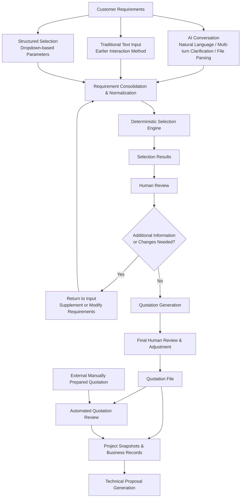
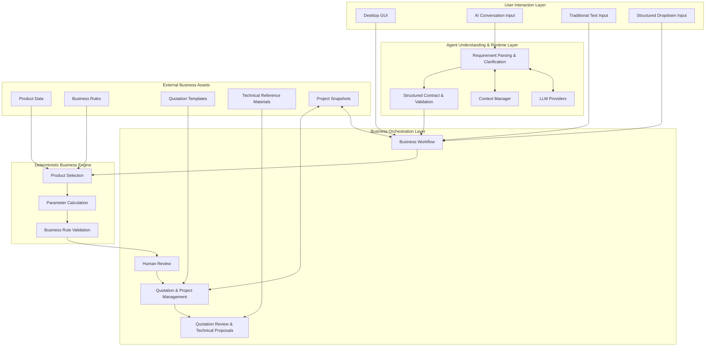
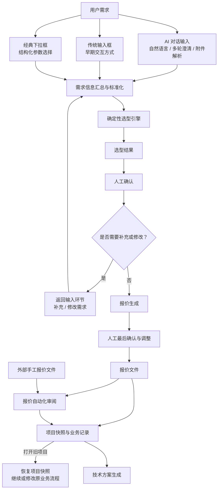
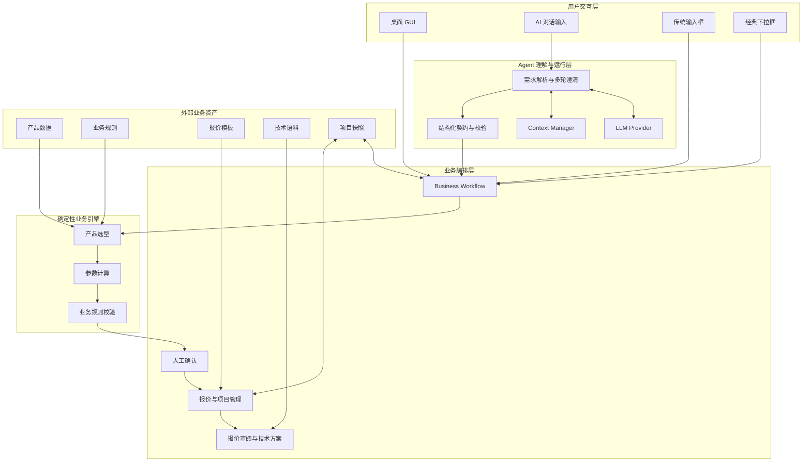

# EN-English Intro.

## COPA — Industrial Weighing Equipment Selection & Quotation Agent

> Turning business experience into executable system capabilities.

### 1. Overview

COPA is a vertical-domain AI agent designed for industrial weighing equipment selection and quotation.

It originated from a practical business need: transforming fragmented engineering expertise, product specifications, and business rules into a maintainable and verifiable software system.

Rather than relying on an LLM to make technical decisions, COPA combines natural-language understanding with a deterministic business engine. The LLM interprets customer requirements and helps clarify missing information, while product selection, parameter calculations, and business rule enforcement remain under deterministic software control.

The system connects the process from customer requirement intake to equipment selection, quotation generation, quotation review, and technical document preparation.

**Core principle: AI interprets requirements, rules execute calculations, and humans retain decision-making authority.**

### 2. End-to-End Business Workflow

COPA supports multiple ways to enter customer requirements, while keeping the downstream business logic consistent.



#### 2.1 Requirement Intake

COPA provides three requirement input methods:

- **AI conversation:** Describe requirements in natural language, provide additional information through multi-turn interaction, or attach supporting documents.
- **Traditional text input:** Enter technical and commercial parameters directly.
- **Structured selection:** Use predefined dropdown options for parameter-based input.

These methods converge into the same requirement processing and business execution pipeline.

#### 2.2 AI-assisted Requirement Understanding

The AI module interprets natural-language requirements and extracts structured information according to COPA's predefined data contract.

It supports multi-turn clarification when required information is missing or cannot be reliably interpreted.

The local parsing module also supports common document formats, including TXT, Markdown, CSV, HTML, XLS, XLSX, XLSM, DOC, and DOCX.

The AI interaction loop ends when either of the following conditions is met:

1. The model identifies that the user is inclined to finish providing information.
2. The user explicitly requests the end of input through supported commands or keywords.

This does not mean that every required field must already be complete. Remaining information gaps can be handled during the subsequent human review stage, where users can modify the proposed results or return to traditional input to supplement the requirements.

#### 2.3 Deterministic Product Selection

After requirement consolidation, COPA passes the structured information to its deterministic selection engine.

Product selection, parameter calculations, and business rule validation are performed by conventional software logic rather than delegated to the LLM.

This ensures that different input methods ultimately follow the same selection rules.

#### 2.4 Human Review and Adjustment

Before quotation generation, users review the proposed selection results.

They can confirm the information, modify parameters, accept or reject individual results, and return to the input stage when further clarification is needed.

The system is designed around professional users and does not attempt to automate every technical judgment.

#### 2.5 Quotation and Subsequent Processing

After confirmation, COPA generates Excel quotations based on the selected products, customer information, project details, language, and quotation templates.

Users can review and manually adjust the generated quotation before delivery.

Quotation files can subsequently be submitted to the automated review module. COPA also supports reviewing externally prepared quotations.

The system can generate technical proposals in Word format using project information and the available technical reference materials.

### 3. Core Design Principles

#### 3.1 Separate Uncertainty from Deterministic Execution

Customer requirements are often incomplete, ambiguous, or expressed in inconsistent ways.

COPA confines this uncertainty primarily to the requirement-understanding stage. Once information has been structured and passed to the business pipeline, selection and calculation are handled by deterministic logic.

The objective is not to eliminate every uncertainty, but to define how unresolved information is handed over to the appropriate stage.

#### 3.2 Respect User Intent During Requirement Clarification

A requirement-understanding loop should not continue indefinitely simply because some information is missing.

COPA considers the user's intention to finish providing information as an explicit signal. Any unresolved gaps can then be addressed through human review or traditional input.

This keeps the AI interaction focused and avoids forcing every problem into the LLM conversation.

#### 3.3 Agentification Does Not Mean Automating Everything

COPA does not attempt to turn the entire business process into an autonomous AI workflow.

Instead, it introduces AI where language understanding and contextual interpretation are genuinely useful, while retaining conventional software for deterministic operations.

The Agent handles requirement interpretation and clarification. The existing application and business engine remain responsible for execution, validation, and delivery.

#### 3.4 Different Inputs, One Business Logic

Whether requirements are entered through AI conversation, traditional text input, or structured selection, they eventually converge into the same business processing pipeline.

The input method does not change the underlying selection rules.

#### 3.5 Decouple Business Knowledge, Data, and Execution Logic

COPA separates product data, business rules, quotation templates, technical reference materials, and project records from its core execution code.

This allows business assets to be maintained independently and provides room for future data-layer evolution without requiring fundamental changes to the business logic.

### 4. Agent and Software Architecture

#### 4.1 Architectural Overview

COPA uses a layered architecture that separates user interaction, AI-based requirement understanding, business workflow orchestration, deterministic execution, and external business assets.



#### 4.2 Agent Runtime: A Bounded Cognitive Loop

The Agent Runtime is responsible for requirement understanding and clarification, rather than controlling the entire business process.

Its main interaction cycle is:

1. **Input:** Receive natural-language descriptions, structured information, and supported attachments.
2. **Interpretation:** Use an LLM to interpret the input and produce structured requirement data according to the predefined contract.
3. **Validation:** The runtime checks the structured output against the expected schema and business-required information.
4. **Clarification:** If information is missing or cannot be reliably interpreted, the system requests additional input from the user.
5. **Loop termination:** The current understanding loop ends when the system detects a user-intent signal to finish input, either through model interpretation or explicit user commands.

The resulting structured information is then passed to the conventional business workflow.

Importantly, ending the AI interaction loop does not mean the entire business process is complete. Human review and subsequent business operations continue independently.

#### 4.3 Structured Contracts and Validation

The AI module does not directly write arbitrary values into the business engine.

Instead, its output is constrained by a structured data contract:

- The expected schema defines the permitted fields and data structures.
- Model-generated values are explicitly distinguished from user-confirmed values.
- Validation failures are returned with structured error information for subsequent correction.
- Confirmation status is controlled by the application rather than being assigned by the model.

This creates a controlled boundary between probabilistic language understanding and deterministic business execution.

#### 4.4 Context Management

COPA maintains multi-turn conversation context and manages structured information incrementally.

Its context management includes:

- Incremental merging of information across conversation turns.
- Dynamic injection of validation feedback without permanently appending it to the conversation history.
- Session archiving and restoration.
- Separation of project information from user input preferences.
- Distinction between application-generated fields and model-generated fields.

Multiple LLM providers and models can be configured and switched through the provider layer.

### 5. Project Records and Business Traceability

COPA maintains project records throughout the business process.

A project snapshot captures the information needed to preserve and resume the relevant business state, including requirement input, selection results, and quotation records.

Quotation files also contain an embedded project identifier, allowing subsequent review operations to associate a quotation with its originating project record.

#### Automated Quotation Review

The quotation review module applies 41 predefined rules to check quotation consistency and completeness.

Examples include:

- Product model and description consistency.
- Product model code validity.
- Price calculation and total consistency.
- Missing or incomplete quotation information.
- Basic rationality and formatting checks.

The review module focuses on mechanical consistency and completeness. It does **not** replace professional judgment or determine whether the original equipment selection is technically correct.

COPA distinguishes between quotations generated by the system and externally prepared quotations. This allows the review process to account for manual modifications and different quotation origins.

### 6. Project Structure

The project separates application code from external business assets.

```text
COPA/
├── main.py
├── COPA.spec
│
├── config/
│   ├── parser_rules.json
│   └── selection_rules.json
│
├── data/
│   └── Product data files
│
├── engine/
│   └── Deterministic business logic
│
├── llm/
│   ├── rules/
│   │   └── Requirement interpretation rules
│   └── providers.json
│
├── template/
│   └── Quotation templates
│
├── library/
│   └── Technical reference materials
│
├── apps/
│   └── sDocBuilder/
│       └── Technical proposal generation
│
├── snapshot/
│   └── Project records
│
└── output/
    └── Generated files
```

The directory tree above illustrates the main organizational structure. Individual files and assets may vary between releases.

Business assets are maintained separately from the core application code. Product information, selection rules, quotation templates, and technical reference materials can therefore be updated independently in supported workflows.

The deterministic engine is designed to remain independent of the GUI framework and presentation layer, making its business logic easier to maintain and extend.

### 7. Technology Stack

| Component                    | Technology             |
| ---------------------------- | ---------------------- |
| Programming Language         | Python 3.10+           |
| Desktop GUI                  | PySide6-Essentials     |
| Product Data & Configuration | CSV, JSON              |
| Excel Processing             | openpyxl               |
| Word Document Generation     | python-docx            |
| AI Integration               | Multiple LLM Providers |
| Application Packaging        | PyInstaller            |

The core business engine is implemented as a standalone calculation and rule-processing layer. It does not depend on the Qt interface or GUI state.

The application is packaged for Windows desktop deployment. External business assets are maintained alongside the packaged application, allowing supported data and configuration updates without rebuilding the executable.

### 8. Current Version and Scope

**Current Version: v1.42 External**

#### Implemented Product Categories

- Weighing Modules
- Platform Scales
- Bench Scales

The application supports product selection across the currently configured brands and product data.

Automotive scales are included in the broader product roadmap, but their selection workflow has not yet been implemented.

#### Current Functional Scope

- Natural-language and structured requirement input.
- Multi-turn AI-assisted requirement clarification.
- Local parsing of supported document formats.
- Deterministic product selection and parameter calculation.
- Human review and manual adjustment.
- Excel quotation generation.
- Automated quotation consistency and completeness review.
- Project snapshots and restoration.
- Word technical proposal generation.

#### Operational Notes

- The AI requirement-understanding module requires access to a configured LLM service.
- The offline demonstration mode is intended to demonstrate application workflows; it does not provide full offline LLM inference.
- Product selection and calculation are performed by the deterministic business engine, not by the LLM.
- Supported product categories and functions are determined by the current release and its external business assets.

### 9. Design Philosophy

COPA is built around a simple distinction:

**AI should participate where interpretation is needed, while deterministic software should remain responsible for what can be defined, calculated, and verified.**

Agentification does not require every workflow to become autonomous. It requires a deliberate decision about where AI adds value, where conventional software is more reliable, and where control should return to the user.

By combining bounded AI-assisted understanding, deterministic business execution, and human review, COPA aims to turn practical business knowledge into reusable, maintainable, and traceable system capabilities.

---

**COPA v1.42 External**
Industrial Weighing Equipment Selection & Quotation Agent


---

# CN-中文介绍

## COPA — 工业称重设备选型与报价 Agent

> 让业务经验成为可执行的系统能力。

COPA 是一款面向工业称重设备配置与报价的垂直领域 AI Agent。项目从实际业务场景出发，将原本分散于工程师经验、产品资料和业务规则中的知识，转化为可维护、可复核、可持续演进的软件系统。

COPA 将 LLM 的自然语言理解能力与确定性业务引擎相结合，支持从客户需求理解、信息澄清、产品选型到报价生成、报价批阅及技术方案编制的完整业务流程。

它并不试图让 AI 接管所有工作，而是通过合理划分模型、程序与专业人员的职责，让 AI 能力真正进入业务流程，同时保留业务执行的确定性与人工决策权。

---

### 1. 项目概览

COPA 最初从 Excel 选型辅助工具发展而来，随后逐步演进为具有独立业务引擎、数据管理、桌面交互及 Agent Runtime 的完整应用。

目前支持以下称重设备品类：

- **称重模块（Weighing Modules）**
- **平台秤（Platform Scales）**
- **台秤（Bench Scales）**

产品数据覆盖 FT、AW、FAB 等品牌。汽车衡及数字式汽车衡目前保留品类规划，选型流程尚未实现。

#### 核心能力

| 功能模块 | 主要能力                                       |
| -------- | ---------------------------------------------- |
| 需求理解 | 自然语言输入、多轮对话、办公文档解析           |
| 需求澄清 | 识别必要信息缺失，结合用户意愿进行追问         |
| 产品选型 | 基于业务规则完成产品匹配、参数计算与校验       |
| 人工确认 | 支持选型结果审核、调整及信息补充               |
| 报价生成 | 根据项目内容、报价抬头及语言生成标准化报价文件 |
| 报价批阅 | 通过规则检查报价内容的一致性与完整性           |
| 项目追溯 | 保存需求、选型及实际出单记录                   |
| 技术方案 | 基于项目快照与技术语料组织 Word 技术方案       |

**当前版本功能概览：**

- 3 类已实现选型流程的产品品类
- 与实际业务规则对齐的批阅规则
- 可根据不同情况自动切换的报价模板
- 可切换的多 LLM 需求理解模块
- 三段式项目快照与业务追溯机制

---

### 2. 从需求到交付：完整业务工作流

COPA 不将自然语言对话视为业务工作的终点，而是将其作为业务流程的一个入口。

从非结构化客户需求开始，系统逐步完成信息理解、业务处理、人工确认和标准化交付。



#### 2.1 多源需求输入

COPA 支持多种业务输入方式：

- 自然语言描述客户需求；
- 通过结构化表单录入产品参数；
- 在对话中逐步补充或修正信息；
- 拖入办公文档，由系统提取其中的需求内容。

支持本地解析的文件格式包括（暂时不支持图片与PDF）：

`TXT`、`MD`、`CSV`、`HTML`、`XLS`、`XLSX`、`XLSM`、`DOC`、`DOCX`。

不同输入方式最终进入统一的需求理解与业务处理流程。

#### 2.2 AI 需求理解与多轮澄清

COPA 使用 LLM 处理自然语言理解、信息提取和需求归一化。

系统支持多轮对话，并针对业务必要但尚未明确的信息继续追问。用户可以随时补充、修正或结束输入。

需求理解模块不会强制要求所有信息都在对话阶段完成。用户明确表示不再补充，或系统判断用户已表现出结束输入的倾向时，当前理解循环即可结束。

尚未解决的信息由后续人工确认环节承接，而不是让模型通过猜测填补所有空缺。

#### 2.3 确定性产品选型

需求理解完成后，结构化信息进入 COPA 的业务引擎。

选型与计算由确定性业务规则执行，包括：

- 产品类型与配置条件匹配；
- 传感器容量及安全系数计算；
- 产品规格与参数约束校验；
- 品牌、型号及其他业务条件匹配；
- 异常条件识别与必要的人工确认。

LLM 不参与传感器选型计算、容量推导、产品型号决策或价格生成。

#### 2.4 人工确认与业务调整

自动生成的选型结果并不直接等同于最终业务结论。

用户可以在确认环节审核选型结果、选择或调整项目内容。对于需要进一步修改的需求，也可以返回传统录入界面进行补充。

COPA 将人工确认作为正式业务流程的一部分，而不是自动化流程之外的补救措施。

#### 2.5 报价生成与后续处理

确认后的项目进入标准化报价流程。

COPA 根据项目内容、报价抬头、项目数量及语言等条件，使用对应模板生成 XLSX 报价文件。

**报价生成后，还可以继续进行规则批阅、项目记录及技术方案编制。**后续可能还会考虑引入3D简易演示、微信/企业微信对话对接等功能（暂无开发计划）。

---

### 3. 核心设计理念

COPA 的设计并不是简单地将 LLM 接入现有软件，而是从业务流程本身出发，重新组织 AI、确定性程序与专业人员之间的协作关系。

### 3.1 把不确定性留在理解层，把确定性留给计算与交付

真实业务需求往往是不完整的、模糊的，甚至存在多种表达方式。

LLM 擅长处理这些不确定输入，但模型推断不应该直接成为未经验证的业务事实。

因此，COPA 将系统划分为不同职责：

| 参与者         | 职责                             |
| -------------- | -------------------------------- |
| LLM            | 自然语言理解、需求提取、信息澄清 |
| 确定性业务引擎 | 产品匹配、参数计算、规则校验     |
| 专业人员       | 结果确认、业务调整、最终决策     |

模型负责理解，程序负责执行规则，人负责最终确认。

**不把模型的推断伪装成业务事实，也不让不确定的输入直接成为确定的交付结果。**

#### 3.2 需求澄清应尊重用户意愿

传统的信息采集流程通常以字段完整性为目标，但真实业务中，用户不一定能够或愿意提供所有信息。

COPA 的需求理解循环采用两种退出信号：

- **语义判断：** LLM 判断用户是否表现出结束输入的倾向；
- **显式指令：** 用户输入命中结束输入的关键词规则。

这两个信号共同决定需求理解循环是否继续，而不是要求模型无限追问，直到所有字段都被填满。

信息缺失并不意味着必须在当前阶段解决。对于专业用户而言，人工确认、参数调整和传统录入入口同样是有效的信息处理方式。

#### 3.3 Agent 不必接管整个业务流程

Agent 化不意味着把所有工作交给 AI。

COPA 将需要语言理解与上下文处理的部分交给 LLM，将有明确规则和确定性结果的部分交给传统软件。

LLM 的需求理解循环结束后，后续选型、人工确认、报价生成及项目记录由确定性业务管道接续完成。

这种设计避免了为了使用 Agent 而让模型参与每一个执行步骤。

**真正重要的不是 AI 参与了多少流程，而是 AI 是否在正确的环节发挥了作用。**

#### 3.4 不同输入，共用同一套业务执行逻辑

COPA 同时支持自然语言、结构化表单和文档输入。

但这些入口并不会分别维护一套独立的选型逻辑。

无论需求来自哪里，最终都需要经过统一的结构化交接、业务引擎及人工确认流程。

这使得新的输入方式可以持续扩展，而不必重复实现核心业务能力。

#### 3.5 业务知识、数据与执行逻辑相互解耦

产品数据、业务规则、报价模板、技术语料及运行记录分别维护。

这种组织方式使产品型号更新、规则调整、报价版式修改和技术资料扩充不必直接修改核心程序代码。

系统的业务逻辑也不应依赖某一种固定的数据存储形式，为未来的数据规模扩展及数据库迁移保留空间。

---

### 4. Agent 与软件架构

COPA 采用分层设计，将用户交互、Agent Runtime、业务编排、确定性计算和外部业务资产分开组织。

#### 4.1 系统架构



**架构核心：**

- LLM 是可替换的需求理解组件，不是业务规则的执行者。
- Runtime 负责组织上下文、控制交接和推进业务流程。
- 确定性引擎不依赖 GUI 或 LLM，可以独立执行核心计算。
- 外部业务资产与核心程序分离，支持独立维护。
- 人工确认是正式工作流节点，保留业务人员对最终结果的控制权。

#### 4.2 Agent Runtime：有界的认知循环

COPA 的 LLM Loop 与常见的自主工具调用型 Agent 有所不同。

它的主要任务不是持续调用工具直至自主完成所有业务，而是完成需求理解、信息澄清及结构化交接。

其运行过程可以概括为：

1. 接收用户输入及当前项目上下文；
2. 调用 LLM 理解需求并输出结构化信息；
3. 根据业务契约检查输出，并识别必要但缺失或未正确解析的信息；
4. 根据业务契约检查结果及用户输入状态，决定是否继续澄清；
5. 当检测到用户结束输入的信号时，退出当前理解循环，并将当前结构化结果交给后续业务流程。

模型输出中的推断值会被明确标识，并保留来源信息。用户确认状态由程序控制，不由模型自行声明。

这一机制使需求理解循环具有明确的职责边界，也让后续业务系统能够可靠地接收模型输出。

---

### 5. 项目记录与业务追溯

COPA 使用三阶段项目快照记录完整业务过程：

| 快照阶段 | 记录内容                   |
| -------- | -------------------------- |
| 需求快照 | 用户输入及结构化需求参数   |
| 选型快照 | 产品选型结果及相关确认信息 |
| 出单快照 | 实际报价文件对应的业务记录 |

项目快照采用可读、可解析的 Markdown 形式保存。

报价文件中嵌入项目关联标识，出单基线记录进入本地项目快照。后续可以根据项目标识回查相关记录，进行报价复核与问题追溯。

报价批阅模块提供 41 条规则，用于检查报价内容中的一致性及完整性问题，例如：

- 产品型号与描述是否匹配；
- 型号编码是否符合规则；
- 数量及价格汇总是否存在遗漏；
- 报价内容是否存在其他规则定义的问题。

报价批阅属于机械规则检查，不代替专业人员判断原始选型方案是否正确。

---

### 6. 程序模块与目录组织

COPA 将核心程序、业务规则、产品数据、模板、技术语料及运行记录分别组织，避免所有业务知识都固化在程序代码中。

```text
COPA/
│
├── main.py                 # 程序入口
├── COPA.spec               # Windows 打包配置
│
├── config/                 # 配置与业务规则
│   ├── parser_rules.json   # 输入解析规则
│   └── selection_rules.json# 产品选型规则
│
├── data/                   # 产品数据
│   └── *.csv
│
├── engine/                 # 确定性业务计算引擎
│
├── llm/                    # LLM 与 Agent 相关模块
│   ├── rules/              # 模型交互协议与提示词规则
│   └── providers.json      # 模型服务配置（公开版不包含私密凭据）
│
├── template/               # 报价模板
│   └── *.xlsx
│
├── library/                # 技术资料与业务语料
│
├── apps/
│   └── sDocBuilder/        # 技术方案文档编制模块
│
├── snapshot/               # 项目快照与业务记录
│
└── output/                 # 生成文件输出目录
```

#### 模块职责

| 模块                  | 主要职责                                       |
| --------------------- | ---------------------------------------------- |
| `main.py`           | 应用启动及主流程入口                           |
| `engine/`           | 独立的确定性业务计算与选型逻辑                 |
| `llm/`              | LLM Provider、上下文管理、需求理解及结构化交接 |
| `config/`           | 解析规则与选型规则                             |
| `data/`             | 产品规格及相关业务数据                         |
| `template/`         | 标准化报价模板                                 |
| `library/`          | 技术资料与业务语料                             |
| `snapshot/`         | 项目阶段快照与追溯记录                         |
| `apps/sDocBuilder/` | 技术方案文档编制                               |
| `output/`           | 报价及其他业务文件输出                         |

其中，`engine/` 的设计重点是保持业务计算逻辑的独立性：它不依赖 Qt、GUI 状态或 LLM，可以由上层业务流程调用。

规则、产品数据、报价模板及技术语料均可独立维护。对这些业务资产的修改，在不涉及程序接口变化的情况下，无需重新编译核心程序。

---

### 7. 技术栈

| 类别           | 技术               |
| -------------- | ------------------ |
| 开发语言       | Python 3.10+       |
| 桌面界面       | PySide6-Essentials |
| 产品数据       | CSV                |
| 业务规则       | JSON               |
| 表格与报价文件 | openpyxl           |
| Word 文档      | python-docx        |
| AI 能力        | 多 LLM Provider    |
| 应用打包       | PyInstaller        |

---

### 8. 当前版本与功能边界

**v1.42 — External Release**

当前版本已完成从传统选型辅助工具到垂直领域 Agent 的主要演进，并投入实际业务使用。

本版本主要包括：

- 自然语言及多格式文档需求理解；
- 多轮需求澄清与结构化交接；
- 多 LLM Provider 切换；
- 确定性产品选型及参数校验；
- 人工确认与传统录入回退；
- 多模板报价生成；
- 报价规则批阅；
- 项目快照与历史基线追溯；
- 技术方案文档编制。

**当前功能边界：**

- 已实现称重模块、平台秤、台秤的选型流程。
- 汽车衡及数字式汽车衡尚未实现完整选型流程。
- LLM 模块需要配置可用的模型服务；离线演示模式不代表完整的离线 AI 推理能力。
- 实际产品数据、业务规则及报价模板以当前发布版本为准。

---

### 9. 设计理念总结

COPA 的设计并不是为了证明 AI 可以替代传统软件，也不是为了让每个业务步骤都必须经过 LLM。

它试图回答的是另一个问题：

**当 AI 能够理解自然语言、处理模糊需求时，传统业务软件应该如何重新组织自身的能力，才能可靠地接收并利用这些认知成果？**

COPA 给出的实践答案是：

- 让 AI 理解人类表达，而不是要求人类完全适应机器的输入方式，同时保留成熟结构化输入方式；
- 让确定性程序承担确定性工作，而不是让模型重复执行已有规则；
- 让人工确认成为系统设计的一部分，而不是自动化失败后的补救措施；
- 让不同能力通过清晰的接口协作，而不是把所有职责集中到一个模型中。

**AI 的价值不在于接管所有工作，而在于让原本难以被软件处理的知识与需求，能够进入可执行、可验证的业务系统。**

---

### 版本信息

| 项目     | 信息                     |
| -------- | ------------------------ |
| 项目名称 | COPA                     |
| 当前版本 | v1.42                    |
| 发布状态 | External Release          |
| 主要平台 | Windows Desktop          |
| 核心语言 | Python                   |
| 产品领域 | Industrial Weighing      |
| 项目定位 | Vertical-Domain AI Agent |
